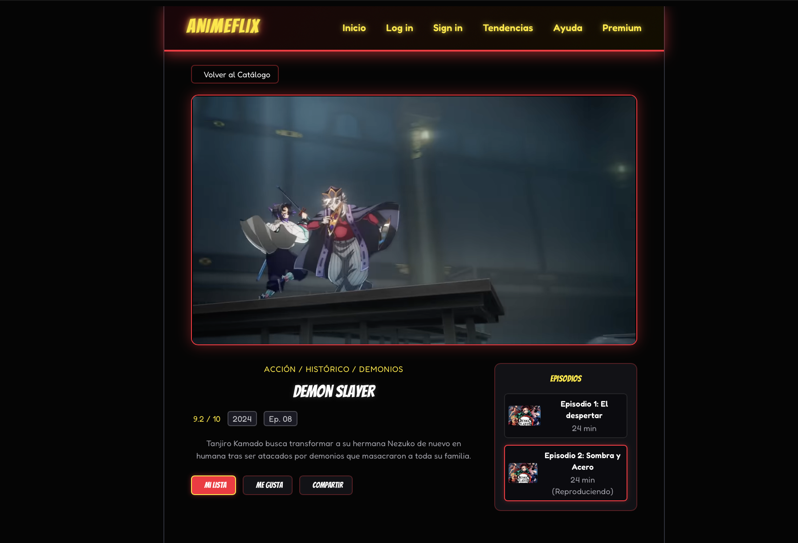
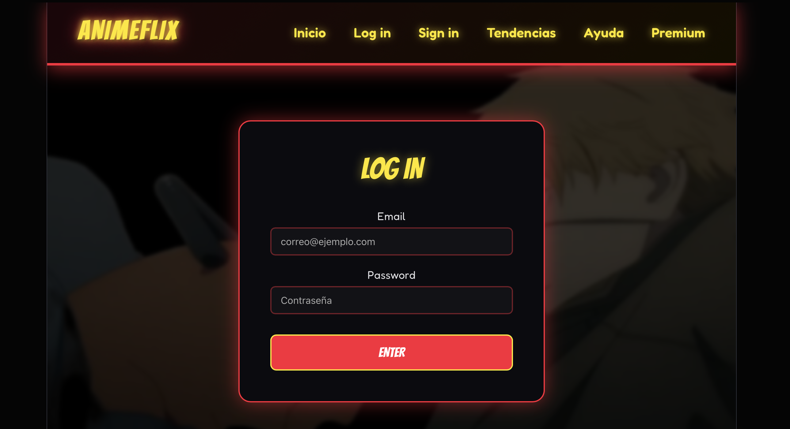
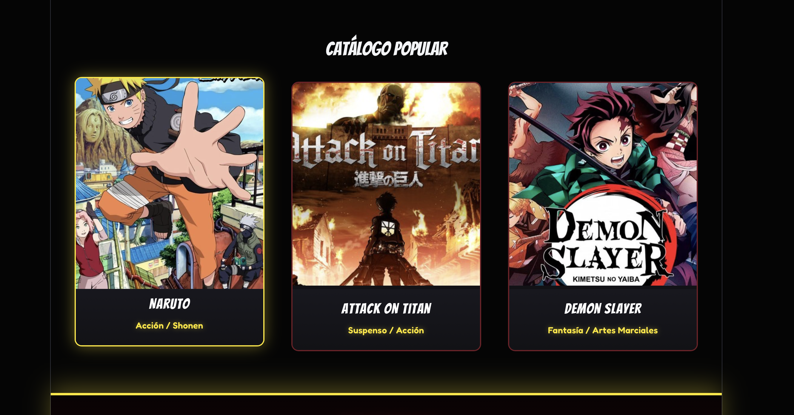

# 🎬 AnimeFlix 

**AnimeFlix** is a Single Page Application (SPA) built with **React** and **Vite**. The platform features a cinematic, neon-accented glassmorphism aesthetic (`#ff1e38` and `#ffe600`), simulated authentication state management, a categorical content catalog with interactive horizontal scrolling, and a dynamic video player powered by YouTube embedded trailers.

---

## 🖼️ Application Preview

> **Note:** Replace the placeholder image paths below (`/docs/screenshots/...`) with the actual relative paths or URLs of your screenshots.

| Home Dashboard | Video Player & Details (`WatchView`) |
| :---: | :---: |
|  |  |

| Authentication View | Responsive Catalog Carousel |
| :---: | :---: |
|  |  |

---

## 🚀 Key Features

- **Dynamic SPA Navigation:** Smooth transitions between views (`index`, `login`, `signin`, `home`, `watch`, `profile`, `premium`, `help`) managed through local React state.
- **Conditional User Navigation (`UserNavbar`):** Tailored navbar for authenticated sessions with quick access to profile settings and logout functionality.
- **Categorized Content Dashboard (`Home`):** Organized anime collections using horizontal scroll tracks (*Trending*, *Shonen/Action*, *Isekai*, *Romance*, *Movies*).
- **Cinematic Video Player (`WatchView`):**
  - Dynamic YouTube `iframe` embedding using unique `trailerId` references.
  - Comprehensive metadata section (Title, Synopsis, Rating, Year, Episode count, Genres).
  - Interactive episode sidebar and action triggers (*My List*, *Like*, *Share*).
- **High-Impact UI/UX:** Neon glassmorphic aesthetics built around a 16:9 aspect ratio standard.

---

## 🛠️ Tech Stack

- **Frontend Framework:** [React.js](https://react.dev/) (Hooks: `useState`, `useRef`)
- **Build Tool:** [Vite](https://vitejs.dev/)
- **Styling:** Custom CSS3 (Variables, Flexbox, CSS Grid, Glassmorphism)
- **Icons:** [FontAwesome](https://fontawesome.com/)
- **Video Engine:** YouTube Embed API / `iframe`

---

## 📁 Project Structure

```text
src/
├── assets/             # Poster images and static media assets
├── components/         # Modular React components
│   ├── Catalog.jsx
│   ├── Footer.jsx
│   ├── Help.jsx
│   ├── Hero.jsx
│   ├── Home.jsx        # Authenticated user dashboard & catalog
│   ├── Login.jsx
│   ├── Navbar.jsx      # Public navigation bar
│   ├── Premium.jsx
│   ├── Signin.jsx
│   ├── Trends.jsx
│   ├── UserNavbar.jsx  # Authenticated session navigation bar
│   └── WatchView.jsx   # Dedicated player and detail view
├── styles/             # Component-level stylesheets
│   ├── home.css
│   ├── userNavbar.css
│   └── watchView.css
├── App.jsx             # Root component & view state orchestrator
└── main.jsx            # Application entry point
```

---

## 🔄 Data Flow & Player Architecture

1. **Selection:** The user clicks the **"Play"** button on an anime card within `Home.jsx`.
2. **State Capture:** The `onClick` handler executes `setSelectedAnime(anime)` to store the selected object and triggers `setCurrentView("watch")`.
3. **Prop Injection:** `App.jsx` conditionally renders `<WatchView />`, passing the selected anime object as a prop.
4. **Dynamic Embedding:** `WatchView.jsx` extracts the `trailerId` property and injects it into the YouTube `iframe` source URL:
   ```jsx
   src={`[https://www.youtube.com/embed/$](https://www.youtube.com/embed/$){animeData.trailerId}?autoplay=1`}
   ```

---

## ⚙️ Installation & Setup

1. **Clone the repository:**
   ```bash
   git clone [https://github.com/your-username/animeflix.git](https://github.com/your-username/animeflix.git)
   cd animeflix
   ```

2. **Install dependencies:**
   ```bash
   npm install
   ```

3. **Start the development server:**
   ```bash
   npm run dev
   ```

4. **Open in browser:**
   Navigate to `http://localhost:5173` in your web browser.

---

## 📄 License

This project was developed for academic and technical portfolio demonstration purposes.
